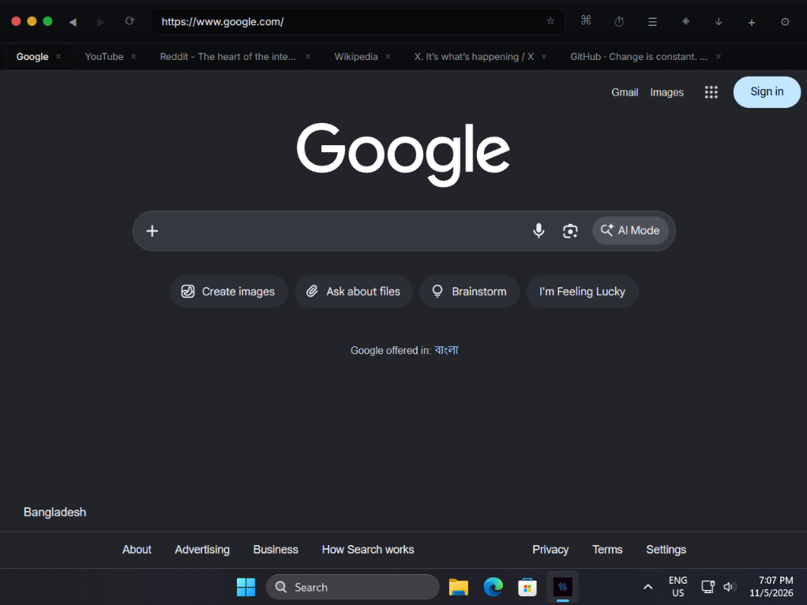
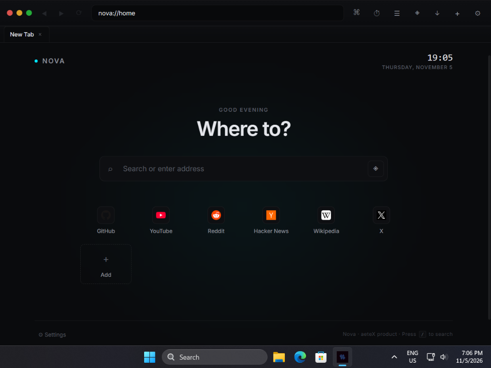
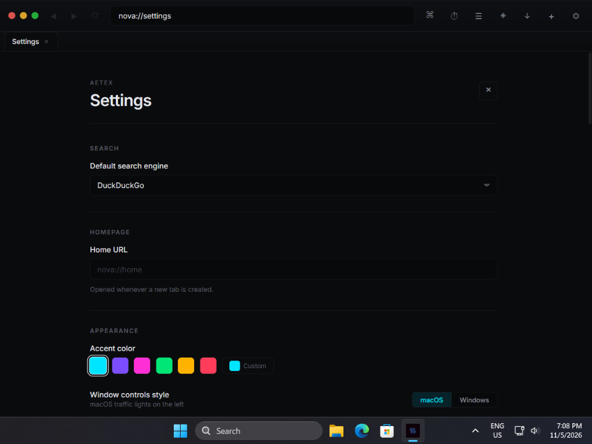

<div align="center">

# Nova

**A futuristic, extensible desktop browser built with Tauri and React.**

[](https://github.com/YOUR_USERNAME/nova/releases)
[](https://github.com/YOUR_USERNAME/nova/actions)
[](LICENSE)
[](https://github.com/YOUR_USERNAME/nova/releases)
[](https://tauri.app)

[Download](#installation) · [Screenshots](#screenshots) · [Features](#features) · [Shortcuts](#keyboard-shortcuts) · [Extensions](#extension-sdk) · [Development](#development) · [Changelog](CHANGELOG.md)

</div>

---

> [!WARNING]
> **Windows only, and the ad blocker is incomplete.**
>
> Nova has only been built and run on Windows. A macOS build path exists
> in the code, but the developer does not own a Mac, so **macOS has never
> been compiled or tested**. If you build Nova on macOS and it works,
> please open an issue to say so — it would be the first confirmation.
>
> The **ad blocker is a work in progress**. EasyList loads and the engine
> evaluates URLs correctly when tested directly, but request interception
> in the live browser is not reliable. On the adblocktester.com suite, Nova
> scores around 8–11% blocked versus 80–90% for Brave and uBlock Origin.
> Do not file "ad blocker doesn't work" as a bug — see
> [CHANGELOG.md](CHANGELOG.md#️-feature-status-ad-blocker) for the current
> state of the feature.

---

Nova is a native browser shell built on **Tauri v2** and **React 19**. It
ships with a local-first AI assistant, a native extension system, a custom
homepage, full history and bookmarks, a command palette, and a cyberpunk-inspired
UI.

## Screenshots



*The main window — custom toolbar, tab strip, per-tab webviews, and the address bar with search fallback.*

<br />

| Homepage | Settings |
|---|---|
|  |  |
| `nova://home` — live clock, quick links, recent downloads | `nova://settings` — rendered as a dedicated tab |

## Platform support

| Platform | Status |
|---|---|
| **Windows 10 / 11** | ✅ Tested and working |
| **macOS** | ⚠️ Untested — code exists, never compiled or run |
| **Linux** | ❌ Not supported (Wayland incompatibility) |
| **Mobile** | ❌ Not supported (Tauri lacks child webviews on mobile) |

## Features

### Native browser core
- **Native child webviews** — each tab is a real OS-level webview, not an iframe
- **Tab strip** with equal-width shrinking, horizontal scroll, overflow menu, and middle-click to close
- **Back / forward / reload** with per-tab history stack and disabled-state indicators
- **Address bar** with search engine fallback, domain auto-detection, and loading-state pulse
- **Animated page-load progress bar** driven by Rust `on_page_load` events
- **Session restore** — open tabs, per-tab history, and active tab come back on next launch (toggleable)
- **Full keyboard shortcut layer** — works whether the page or the chrome has focus

### History and bookmarks
- **`nova://history`** — date-grouped entries, live search, per-entry removal, clear-all
- **`nova://bookmarks`** — searchable list with per-entry removal
- **`Ctrl+D`** toggles the bookmark from anywhere, including from a focused page
- **Bookmark star** lives inside the address bar, right side
- **Bookmarks bar** below the tab strip, off by default, toggled with `Ctrl+Shift+B`
- **Search history** records queries typed into the address bar and surfaces them in the command palette

### Command palette
- **`Ctrl+K`** opens from anywhere
- **Unified search** across history, bookmarks, recent searches, and browser actions
- **URL detection** — typing a domain offers "Go to" as the top result
- **`Ctrl+Enter`** opens any URL result in a new tab; current tab stays put
- **Arrow navigation**, Enter to select, Escape to close

### Custom homepage
- **`nova://home`** with live clock, time-aware greeting, and recent downloads strip
- **Central search bar** — press `/` to focus, `Ctrl+Enter` to open in a new tab
- **Customizable quick links** with favicon fetching, gradient letter fallbacks, and an add-shortcut modal
- **One-click access** to settings, AI panel, and the full downloads page

### AI assistant
- **Local-first** — streams from any llama.cpp server, no cloud required
- **Tool calling** — navigate, open tabs, search, close tabs, read page state, change settings
- **Animated tool cards** with ambient pulse while running, success flash, error shake
- **Orb** in the sidebar header with four states — idle, connecting, streaming, error

### Extension system
- **Sandboxed runtime** — cross-origin iframes over `nova-ext://` with per-extension CSP
- **Typed SDK** with `tabs`, `storage`, `runtime`, `contentScripts`, and `ui` namespaces
- **Two-layer permission enforcement** — frontend router and Rust validator must both pass
- **Side panels** — extensions declaring `"ui": { "panel": "panel.html" }` get a toolbar entry that opens their HTML in the right sidebar
- **Content script injection** with URL glob matching

### Downloads
- **Streaming downloads** via `reqwest` with byte-count progress events
- **Native popover window** — separate React root with its own event loop, immune to page-level interference
- **Pause / resume / cancel** per download, open file and show-in-folder on completion
- **`nova://downloads`** — full page listing with source page URL, file URL, and saved path

### Customizable UI
- **Reorderable toolbar** — move any of ten items in Settings → Toolbar
- **Hide toolbar items** — eye toggle per item; the address bar is protected so you can't lock yourself out
- **Window controls style** — macOS traffic lights (default) or Windows-style buttons, in Settings → Appearance
- **Search engine picker** — DuckDuckGo, Google, Bing, Brave, Startpage, Ecosia, or a custom URL template
- **Accent color** — six presets plus a color picker, applied live to every surface
- **Custom context menu** (opt-in) — neon-styled right-click menu rendered as DOM inside the page
- **AI configuration** — server URL, model name, system prompt, temperature

### Ad blocker (in progress)
- **`adblock-rust`** engine loaded with bundled EasyList (~82,000 rules)
- **Diagnostic panel** in Settings for testing any URL against the engine
- Request interception layer is incomplete — see the warning above

## Keyboard shortcuts

Every shortcut works whether the address bar or a web page has focus.

### Tabs

| Shortcut | Action |
|---|---|
| `Ctrl+T` | New tab |
| `Ctrl+W` | Close active tab |
| `Ctrl+Shift+T` | Reopen last closed tab (up to 20) |
| `Ctrl+Tab` / `Ctrl+Shift+Tab` | Cycle tabs forward / backward |
| `Ctrl+1` … `Ctrl+8` | Jump to tab N |
| `Ctrl+9` | Jump to last tab |
| Middle-click a tab | Close it without activating |

### Navigation

| Shortcut | Action |
|---|---|
| `Ctrl+L` / `F6` | Focus address bar |
| `Ctrl+R` / `F5` | Reload |
| `Alt+←` / `Alt+→` | Back / forward |
| `Escape` | Close overlay, or revert address bar |

### Browser features

| Shortcut | Action |
|---|---|
| `Ctrl+K` | Command palette |
| `Ctrl+D` | Bookmark toggle |
| `Ctrl+Shift+B` | Toggle bookmarks bar |
| `/` on homepage | Focus homepage search |

## Installation

Download the latest release from the [Releases page](https://github.com/YOUR_USERNAME/nova/releases).

| Platform | File | Notes |
|---|---|---|
| Windows | `Nova_0.1.1_x64-setup.exe` | Recommended. Start Menu entry + uninstaller. |
| Windows | `Nova_0.1.1_x64_en-US.msi` | Enterprise / Group Policy |
| macOS | `Nova_0.1.1_x64.dmg` | ⚠️ Not available until validated on macOS |

### First launch

The Windows installer isn't code-signed, so Defender SmartScreen will warn you.
Click **More info → Run anyway**. This warning appears because signing
certificates cost money, not because the installer is unsafe — you can inspect
the source in this repository.

### Enabling the AI assistant

1. Download `llama-server` from the [llama.cpp releases page](https://github.com/ggml-org/llama.cpp/releases)
2. Download a GGUF model — Llama 3.2 3B or Qwen 2.5 7B are good starting points
3. Run `./llama-server -m your-model.gguf -c 4096 --host 127.0.0.1 --port 8080`
4. In Nova, open **Settings → AI Assistant** and toggle **Enable**
5. Click the **◈** button in the toolbar

## Extension SDK

```js
defineExtension("com.example.my-ext", (nova) => {
  nova.runtime.onMessage.addListener((msg) => {
    if (msg.type === "ping") return { type: "pong" };
  });

  nova.tabs.onUpdated.addListener(({ tabId, changes }) => {
    if (changes.status === "complete") {
      console.log("Tab finished loading:", tabId);
    }
  });
});
```

Extensions are installed by dropping a folder into the directory shown in
**Settings → Extensions**. The full manifest reference, SDK API, URL match
patterns, and security model are documented in
[docs/EXTENSIONS.md](docs/EXTENSIONS.md).

**Available permissions:** `tabs.read`, `tabs.write`, `tabs.navigate`,
`storage.local`, `storage.sync`, `messaging`, `contentScripts`, `ui.popup`,
`ui.panel`, `notifications`, `webRequest`.

## Development

### Prerequisites

| Dependency | Version | Install |
|---|---|---|
| Rust | 1.77+ | [rustup.rs](https://rustup.rs) |
| Node.js | 20+ | [nodejs.org](https://nodejs.org) |
| Platform toolchain | — | See below |

**Windows:** Microsoft C++ Build Tools (check "Desktop development with C++")
and WebView2 Runtime (pre-installed on Windows 11,
[download for Windows 10](https://developer.microsoft.com/microsoft-edge/webview2/)).

**macOS:** `xcode-select --install`. Note that no successful macOS build
has been reported yet — expect to fix some compile issues if you try.

### Setup

```bash
git clone https://github.com/YOUR_USERNAME/nova.git
cd nova
npm install
```

### Development build

```bash
npm run tauri dev
```

The first launch compiles the Rust backend in debug mode — expect 2–3
minutes. Subsequent launches are near-instant.

### Production build

The repo ships with cross-platform build scripts that check prerequisites,
install dependencies, run the full Tauri pipeline, and print the location
and size of every installer produced.

**Windows**

```powershell
.\scripts\build.ps1
```

Or double-click `scripts\build.bat` — it launches the PowerShell script with
an execution-policy bypass so you never need to touch `Set-ExecutionPolicy`.

**macOS (untested)**

```bash
chmod +x scripts/build.sh   # one-time after cloning
./scripts/build.sh
```

**Build flags**

| PowerShell | Shell | Effect |
|---|---|---|
| `-Clean` | `--clean` | Wipe `dist/` and `src-tauri/target/` first |
| `-FrontendOnly` | `--frontend` | Build only the frontend |
| `-NoBundle` | `--no-bundle` | Raw executable, skip installers |
| `-SkipInstall` | `--skip-install` | Skip `npm install` (for CI) |
| `-NoPause` | `--no-pause` | Skip end-of-run pause |

**Manual build**

```bash
npm run tauri build
```

Outputs land in `src-tauri/target/release/bundle/`:

- **Windows** — `bundle/msi/*.msi` and `bundle/nsis/*-setup.exe`
- **macOS** — `bundle/dmg/*.dmg` (once validated)

### Other commands

| Command | What it does |
|---|---|
| `npm run dev` | Vite dev server only (no Tauri shell) |
| `npm run typecheck` | Full TypeScript check across the project |
| `npm run clean` | Remove `dist/` and `src-tauri/target/` |
| `npm run clean:frontend` | Remove `dist/` only |
| `npm run clean:rust` | Run `cargo clean` |

## Architecture

Nova is split into three cooperating layers:

1. **Frontend (React + TypeScript)** — toolbar, tabs, settings, AI panel, extension manager
2. **Rust core (Tauri)** — webview lifecycle, extension discovery, custom URI scheme, permission enforcement
3. **Extension runtime** — sandboxed iframes plus a `postMessage` IPC bridge

See **[docs/ARCHITECTURE.md](docs/ARCHITECTURE.md)** for the full diagram and
details on the IPC protocol, AI tool loop, and security model.

### Project structure

```
nova/
├── src/                          React frontend
│   ├── components/               UI (Browser, Settings, HomePage, AIPanel, …)
│   ├── hooks/                    Settings, extensions, downloads, AI, storage
│   ├── extension-sdk/            SDK shipped to extension authors
│   └── extension-host/           Host-side extension runtime
├── src-tauri/                    Rust backend
│   ├── src/                      lib.rs, downloads, adblocker, storage, extensions
│   ├── filters/                  EasyList and WebKit rule JSON
│   └── embedded/                 Bundled extension SDK
├── docs/
│   ├── screenshots/              README images
│   ├── ARCHITECTURE.md
│   └── EXTENSIONS.md
├── scripts/                      Build scripts (build.ps1, build.sh, build.bat)
├── CHANGELOG.md
└── package.json
```

## Tech stack

| Layer | Technology |
|---|---|
| Frontend | React 19, TypeScript 6, Vite 8 |
| Styling | Plain CSS with custom properties |
| Native shell | Tauri 2, WebView2 (Windows), WKWebView (macOS) |
| Backend | Rust 2021 edition, `serde`, `reqwest`, `parking_lot` |
| Ad blocking | `adblock-rust` 0.13 |
| AI | llama.cpp OpenAI-compatible API, Server-Sent Events streaming |

## Roadmap

- [x] Native tab rendering with child webviews
- [x] AI assistant with llama.cpp streaming
- [x] AI tool calling (navigate, search, tabs, settings)
- [x] Extension system with typed SDK
- [x] Back / forward / reload with per-tab history
- [x] Loading bar driven by Rust page-load events
- [x] Cross-platform build scripts
- [x] Custom homepage (`nova://home`)
- [x] Downloads manager with native popover
- [x] History and bookmarks
- [x] Session restore on launch
- [x] Command palette (`Ctrl+K`)
- [x] Extension side panels
- [x] Full keyboard shortcut layer
- [x] Customizable toolbar (reorder + hide)
- [ ] Complete Windows ad blocker interception
- [ ] macOS build validation
- [ ] Extension popup surface
- [ ] History and bookmarks export / import
- [ ] Tab groups
- [ ] Custom new-tab layout editor
- [ ] Extension signing (Ed25519)
- [ ] Auto-update via Tauri updater

## Contributing

Contributions are especially welcome for:

- **macOS validation** — if you have a Mac, try building and open an issue
  with the errors or the good news
- **Windows ad blocker interception** — the handler is not firing for most
  requests, and any insight into `ICoreWebView2_22` behavior on child
  webviews would help
- **EasyList → WebKit JSON conversion** — the macOS blocker needs a proper
  converter to reach meaningful coverage

```bash
# Type-check the whole project
npm run typecheck

# Run the Rust tests
cd src-tauri && cargo test

# Full release build
./build.sh --clean
```

Please keep PRs scoped to one change and include a short description of the
*why* alongside the *what*.

## License

MIT — see [LICENSE](LICENSE). Bundled filter lists are licensed separately;
see `src-tauri/filters/README.md`.

---

<div align="center">Built by <strong>AeteX</strong></div>